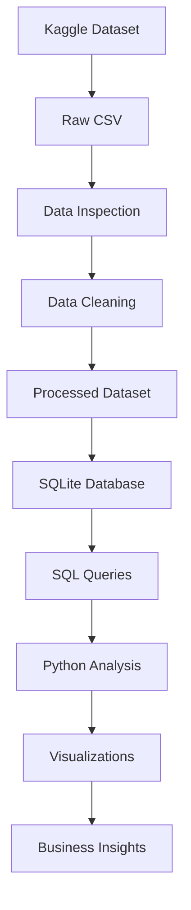

# Online Retail Data Analysis

A data analysis project exploring historical e-commerce transactions from a UK-based online retailer. This project uses Python, pandas, and SQL to clean transaction data, investigate sales performance, and derive business insights through exploratory data analysis and visualization.

The objective is to demonstrate a complete data analysis workflow, from raw data acquisition to actionable business recommendations.

## Project Objectives

- Acquire and inspect real-world transaction data.
- Clean and preprocess raw data for analysis.
- Store structured transaction data in a relational database.
- Use SQL to retrieve and aggregate business metrics.
- Analyze sales performance, product trends, and customer behavior.
- Visualize findings and communicate business insights.

## Tech Stack

| Technology | Purpose |
|---|---|
| Python | Main programming language for data processing and analysis |
| pandas | Data cleaning, transformation, aggregation, and manipulation |
| SQLite | Relational database for storing and querying transaction data |
| sqlite3 | Python's built-in interface for connecting to SQLite |
| Matplotlib | Data visualization and presentation of analytical findings |

### Why These Technologies?

**Python**

Python provides a flexible environment for data analysis, automation, and statistical computing. Its extensive ecosystem makes it suitable for both exploratory analysis and more advanced analytical projects.

**pandas**

pandas provides DataFrame structures for working with tabular data. It simplifies common data preparation tasks such as handling missing values, converting data types, filtering records, and calculating metrics.

**SQLite**

SQLite provides a lightweight relational database without requiring a separate database server. It allows the project to practice SQL querying, aggregation, and data storage while keeping the setup simple and portable.

**Matplotlib**

Matplotlib is used to visualize analytical results through charts such as revenue trends, product comparisons, and customer distribution. Visualizations help communicate findings more effectively than raw tables alone.

## Dataset

The project uses the [Online Retail dataset from Kaggle](https://www.kaggle.com/datasets/carrie1/ecommerce-data).

The dataset contains historical transaction records from a UK-based online retailer, covering approximately December 2010 to December 2011.

### Dataset Features

| Column | Description |
|---|---|
| InvoiceNo | Transaction or invoice identifier |
| StockCode | Product identifier |
| Description | Product description |
| Quantity | Number of units purchased |
| InvoiceDate | Date and time of transaction |
| UnitPrice | Price per unit |
| CustomerID | Customer identifier |
| Country | Customer's country |

The dataset contains real-world data quality challenges, including missing customer identifiers, cancelled invoices, negative quantities, and inconsistent product descriptions.

These characteristics provide an opportunity to practice data cleaning and analytical decision-making.

## Project Structure

```text
online-retail-data-analysis/
│
├── data/
│   ├── raw/
│   │   └── Online Retail.csv
│   │
│   └── processed/
│       └── cleaned_retail.csv
│
├── database/
│   └── retail.db
│
├── notebooks/
│   └── exploratory_analysis.ipynb
│
├── src/
│   ├── data_cleaning.py
│   ├── database.py
│   └── analysis.py
│
├── sql/
│   ├── sales_analysis.sql
│   └── customer_analysis.sql
│
├── visualizations/
│   └── generated_charts/
│
├── requirements.txt
└── README.md
```

### Folder Responsibilities

**data/raw/**

Stores the original dataset downloaded from Kaggle. The raw data should remain unchanged to preserve the original source and allow the cleaning process to be reproduced.

**data/processed/**

Contains cleaned and transformed data that is ready for analysis or database loading.

**database/**

Stores the SQLite database containing structured transaction data.

**notebooks/**

Contains Jupyter notebooks used for exploratory data analysis, experimentation, and documenting analytical findings.

**src/**

Contains reusable Python scripts responsible for data cleaning, database operations, and analytical calculations.

**sql/**

Contains SQL queries used to investigate sales performance and customer behavior.

**visualizations/**

Stores charts generated during the analysis.

## Data Processing Workflow

The project follows a sequential data processing pipeline.



### 1. Data Acquisition

The dataset is downloaded from Kaggle and stored in the raw data directory.

The original file is preserved to ensure that all transformations can be reproduced.

### 2. Data Inspection

The dataset is loaded into pandas for initial inspection.

The inspection process includes:

- Reviewing column names and data types.
- Checking the number of records.
- Identifying missing values.
- Examining duplicate records.
- Investigating negative quantities and prices.
- Understanding the meaning of transaction records.

### 3. Data Cleaning

The raw dataset is transformed into a consistent and usable format.

Potential cleaning operations include:

- Converting transaction dates into datetime objects.
- Handling missing product descriptions.
- Investigating missing customer identifiers.
- Identifying cancelled transactions.
- Validating quantity and price values.
- Removing or handling duplicate records where appropriate.

Cleaning decisions are based on the analytical objective rather than automatically removing every unusual record.

For example, negative quantities may represent returned or cancelled purchases. These records may need to be excluded from gross sales analysis but retained when investigating returns or net revenue.

### 4. Database Loading

After cleaning, the processed dataset is loaded into SQLite.

The database provides a structured environment for querying transaction data using SQL.

The initial implementation uses a transaction-level table containing product, invoice, customer, and sales information.

### 5. SQL Analysis

SQL is used to retrieve and aggregate data directly from the database.

Examples of analytical queries include:

- Revenue by country.
- Revenue by product.
- Monthly sales trends.
- Customer purchase frequency.
- Average transaction value.
- Product return and cancellation analysis.

### 6. Python Analysis

SQL query results are loaded into pandas DataFrames for further analysis.

Python is used to calculate additional metrics, compare performance, and prepare data for visualization.

### 7. Visualization and Reporting

Matplotlib is used to generate charts that communicate the analytical results
